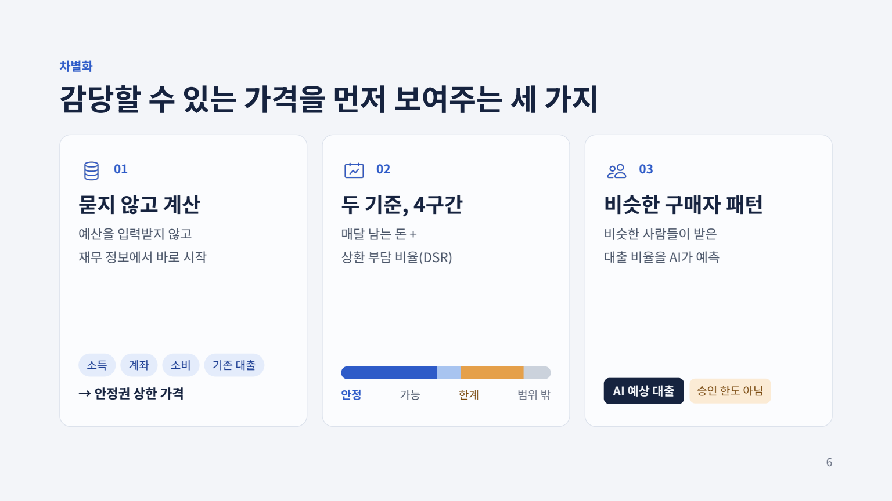
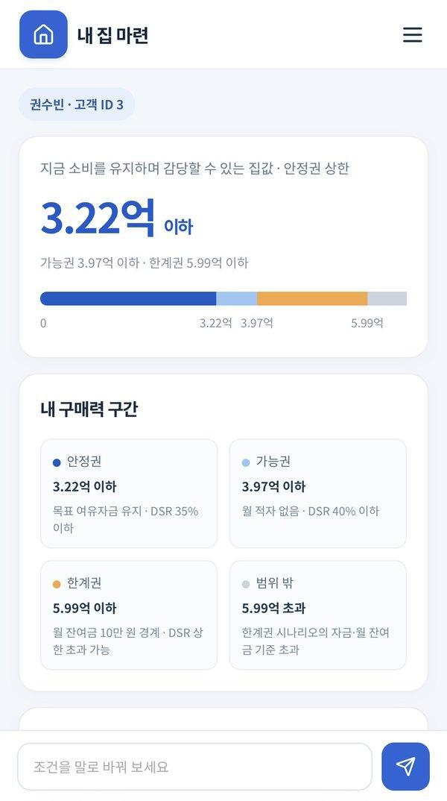
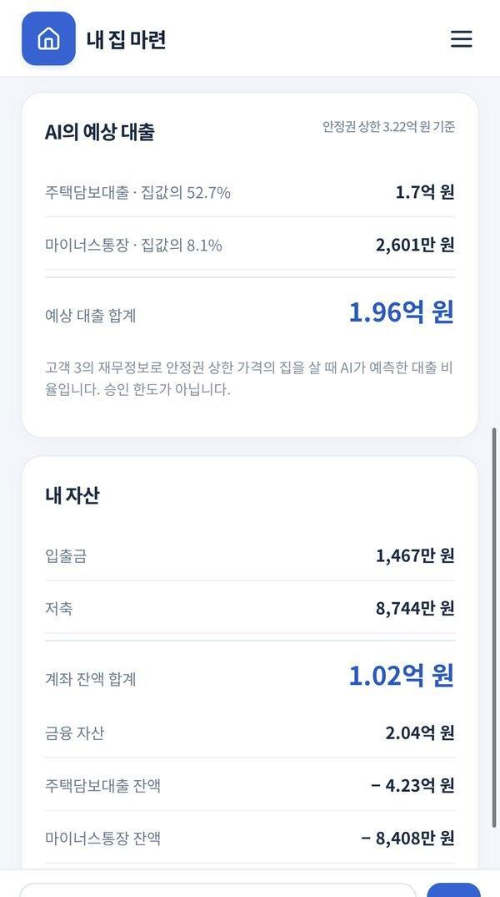
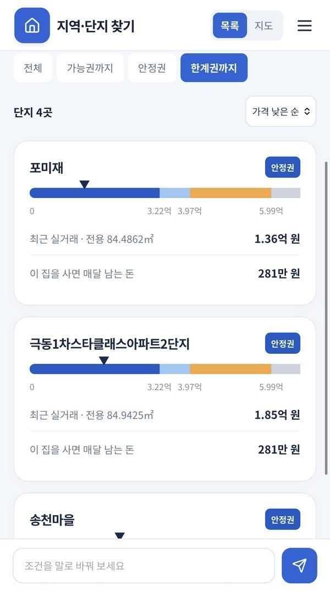
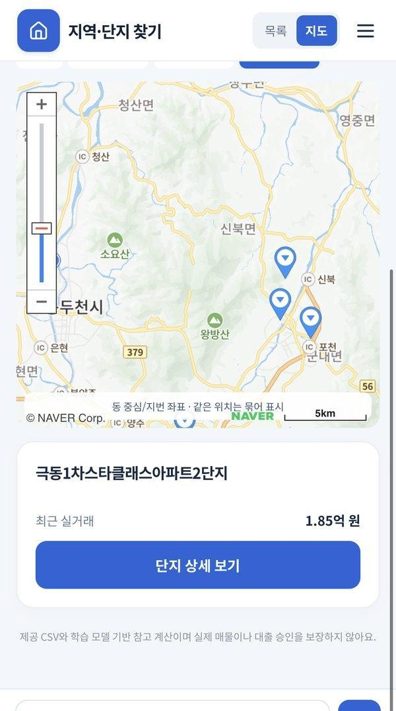
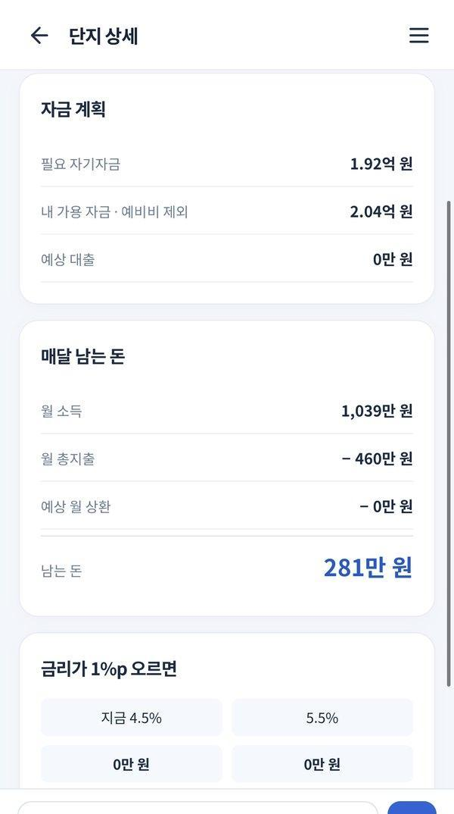
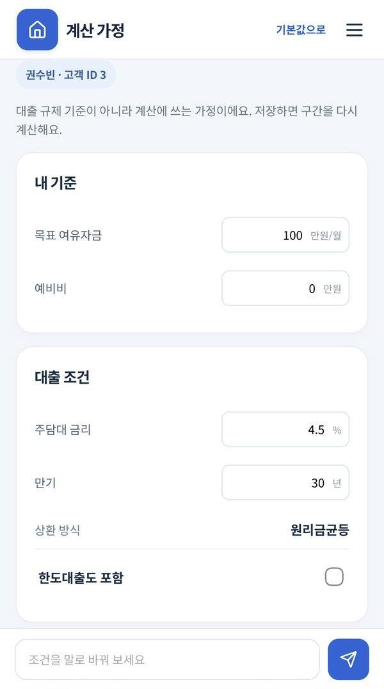
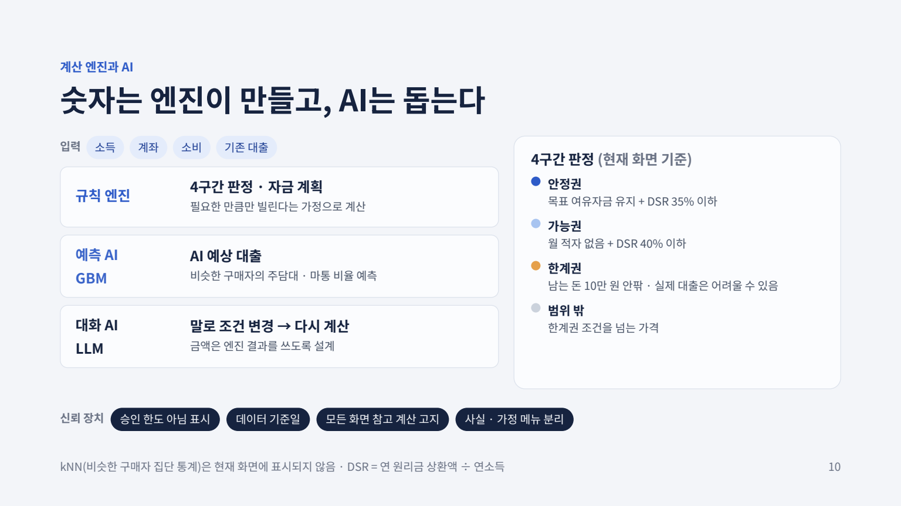

# 산화머니 — 감당할 수 있는 집값부터 계산하는 내 집 마련

**“내 재무 상황으로 얼마짜리 집까지 살 수 있을까?”**

산화머니는 고객의 소득·금융자산·소비·기존 대출을 바탕으로 구매력을 계산하고, 예산에 맞는 주택 탐색부터 대출·월 상환 계획까지 연결하는 모바일 웹앱입니다. 학습 모델이 비슷한 구매자의 대출 비율을 예측하고, 계산 엔진이 매달 남는 돈과 상환 부담을 확인합니다. AI 채팅으로 원하는 지역을 말하면 현재 재무 조건으로 조회·계산한 후보를 설명합니다.

AI CAMPUS 미니 프로젝트 · 팀 산'화'머니 · 최종 발표 2026.10.09

[서비스 화면](#서비스-화면) · [구매력 계산과 AI](#구매력-계산과-ai) · [설계 구조](docs/architecture.md) · [실행 방법](#빠른-시작-windows) · [발표자료 PDF](docs/presentation/service-introduction.pdf)



## 서비스 화면

**고객 선택 → 내 구매력 확인 → 지역·단지 탐색 → 단지별 자금 계획** 순서로 이용합니다. 모든 화면 하단에서 AI 대화를 시작할 수 있습니다.

아래는 최종 발표자료에 사용한 실제 앱 화면입니다. 2026.10.08 캡처이며, 표시된 금액은 시연 고객 한 명의 예시입니다. 이미지를 클릭하면 크게 볼 수 있습니다.

<table>
  <tr>
    <th width="33%">① 내 구매력</th>
    <th width="33%">② AI 예상 대출</th>
    <th width="33%">③ 지역·단지 목록</th>
  </tr>
  <tr>
    <td align="center"><a href="docs/images/service/purchasing-power.jpg"></a></td>
    <td align="center"><a href="docs/images/service/loan-prediction.jpg"></a></td>
    <td align="center"><a href="docs/images/service/complex-list.jpg"></a></td>
  </tr>
  <tr>
    <td>현재 소비를 유지하면서 감당할 수 있는 집값과 4개 구매력 구간을 확인합니다.</td>
    <td>비슷한 구매자의 대출 비율·예측 금액과 고객의 금융자산을 확인합니다.</td>
    <td>지역·면적·거래 기간을 고르고 구매력 구간에 맞는 단지를 비교합니다.</td>
  </tr>
  <tr>
    <th>④ 네이버 지도</th>
    <th>⑤ 단지 자금 계획</th>
    <th>⑥ 계산 가정</th>
  </tr>
  <tr>
    <td align="center"><a href="docs/images/service/naver-map.jpg"></a></td>
    <td align="center"><a href="docs/images/service/funding-plan.jpg"></a></td>
    <td align="center"><a href="docs/images/service/assumptions.jpg"></a></td>
  </tr>
  <tr>
    <td>목록과 지도를 전환해 단지 위치를 확인하고 상세 화면으로 이동합니다. 같은 위치의 단지는 묶어 표시합니다.</td>
    <td>선택한 집의 자기자금·대출·월 상환·월 잔여금을 확인하고 금리 +1%p 상황을 비교합니다.</td>
    <td>목표 여유자금, 예비비, 금리, 만기 등 계산 조건을 바꾸고 구매력을 다시 계산합니다.</td>
  </tr>
</table>

AI 채팅에서는 “서대문구에서 내가 구매할 만한 주택 3개 추천해줘”처럼 질문할 수 있습니다. 현재 고객의 조건으로 해당 지역을 검색하고, 검증된 후보의 거래 참조가격·예상 대출·월 상환액을 카드로 보여줍니다. 조건을 충족하는 후보가 없으면 없다고 안내합니다.

## 구매력 계산과 AI



| 구성 | 역할 |
|---|---|
| 재무 정보 | 소득·계좌·소비·기존 대출을 고객 ID로 연결해 계산에 반영 |
| 대출 예측 모델 (GBM) | 비슷한 구매자의 주택담보대출·한도대출 비율 예측 |
| 계산 엔진 | 필요한 자금, 대출 상환액, 월 잔여금과 DSR을 계산해 구매력 판정 |
| 대화 AI (LLM) | 자연어 요청에 따라 도구로 지역을 변경·조회하고 계산 결과 설명 |
| 네이버 지도 | 주소 좌표 조회, 단지 위치 표시, 같은 위치의 단지 그룹 표시 |

구매력은 아래 네 구간으로 표시합니다. 기준은 기본 설정이며, 금리·만기·목표 여유자금 등을 바꾸면 가격 경계도 다시 계산됩니다.

| 구간 | 판정 기준 |
|---|---|
| 안정권 | 목표 월 여유자금 유지 + DSR 35% 이하 |
| 가능권 | 월 적자 없음 + DSR 40% 이하 |
| 한계권 | 월 잔여금 10만 원 경계까지의 시나리오. DSR 상한을 초과할 수 있음 |
| 범위 밖 | 한계권 시나리오의 자금·월 잔여금 기준을 넘는 가격 |

DSR은 연간 원리금 상환액을 연소득으로 나눈 비율입니다. **AI 예상 대출은 비슷한 구매자의 대출 패턴 예측값**이고, 단지 자금 계획은 **그 집에 필요한 만큼만 빌리는 계산값**이므로 두 금액은 다를 수 있습니다. 채팅 카드의 금액도 계산 엔진에서 가져옵니다.

## 구현 범위와 다음 단계

현재 시연은 로컬 CSV·DB의 고객 선택으로 로그인·동의·마이데이터 연결 단계를 대신합니다. 단지 가격은 제공 데이터의 최근 거래 참조값이며, 실제 매물·현재 시세·금융기관의 대출 승인을 보장하지 않습니다. 한계권은 상환 부담을 확인하는 시나리오입니다.

다음 단계는 실데이터 검증·재학습, 규제 설정 테이블과 스트레스 DSR 반영, 바로 사용할 수 있는 자산의 구분, 로그인·동의·실시간 마이데이터 및 실거래가 연동입니다.

## 기술 구성

- 백엔드: Python 3.12 · FastAPI · SQLite · scikit-learn(대출 비율 예측) · LangChain + OpenAI Responses API
- 프론트엔드: React 19 · TypeScript · Vite · 네이버 지도
- 배포: Docker 이미지 → AWS ECR → EC2(Docker Compose + Caddy). 자세한 절차는 [배포 안내](docs/deployment.md)

## 빠른 시작 (Windows)

Python 3.12, Node.js 24, pnpm 11을 사용합니다. **저장소에는 CSV·DB·학습 모델이 포함되어 있지 않으므로, 앱 실행 전에 [데이터와 모델 준비](docs/data-setup.md)가 필요합니다.** 소스 코드만 clone하면 고객 조회와 예측을 바로 실행할 수 없습니다.

```bat
cd /d C:\project_side
setup.cmd dev
cd frontend && pnpm install --frozen-lockfile && pnpm build && cd ..
start.cmd
```

http://127.0.0.1:8501 에서 확인합니다. Python 가상환경 이름은 `side`입니다. 처음 설치하는 PC라면 `.env.example`을 `.env`로 복사해 키를 넣습니다. 기존 `.env`는 덮어쓰지 마세요.

## 설정 (`.env`)

| 변수 | 설명 |
|---|---|
| `OPENAI_API_KEY`, `MAIN_MODEL` | AI 채팅 키와 모델 ID |
| `MODEL_TIMEOUT_SECONDS`, `MODEL_MAX_RETRIES` | OpenAI 호출 제한 시간·재시도 (기본 90초·2회) |
| `MODEL_REASONING_EFFORT` | 선택. `low` 등으로 추론 강도 지정 (비우면 모델 기본값) |
| `CHAT_MAX_CONCURRENCY` | 동시에 처리하는 AI 대화 수 (기본 4, 초과분은 대기) |
| `CHAT_HISTORY_TURNS` | 모델에 다시 보내는 이전 대화 턴 수 (기본 6) |
| `NAVER_MAPS_CLIENT_ID`, `NAVER_MAPS_CLIENT_SECRET` | 지도 표시와 주소 좌표 조회 |
| `DATABASE_PATH`, `CHAT_CHECKPOINT_PATH`, `LOG_LEVEL` | 선택. 기본은 `data/housing.sqlite`, `data/chat_checkpoints.sqlite`, `INFO` |

키는 서버에만 있고, 브라우저에는 네이버 지도 공개 Client ID만 전달됩니다.

## 폴더 구조

```text
project_side/
├── housing_app/              # 백엔드
│   ├── api.py                # FastAPI 라우트, 빌드된 화면 제공
│   ├── affordability.py      # 학습 모델 대출 비율 ↔ 계산기 연결 (안정권 상한 기준)
│   ├── finance.py            # 자금 계획·구간 계산 (모든 금액 계산은 여기)
│   ├── llm_advisor.py        # OpenAI 채팅 에이전트와 응답 검증
│   ├── housing_repository.py # 읽기 전용 DB 조회 + 메모리 캐시
│   ├── naver_maps.py         # 지오코딩(병렬)·좌표 캐시
│   ├── recommender.py, prep.py, source_data.py, regions.py, settings.py
├── frontend/src/             # App.tsx, screens/, components/, format.ts, api.ts
├── scripts/                  # 데이터 감사·DB 생성·학습·실행 전 점검(check)
├── tests/                    # pytest (`data` 표시 테스트는 비공개 데이터 필요)
├── deploy/                   # AWS용 compose·Caddy·EC2 설치·ECR 업로드 스크립트
├── docs/                     # 서비스 화면·설계·데이터 준비·배포·발표자료
├── data/, models/            # 비공개 DB·CSV·모델 (Git·이미지 제외)
└── Dockerfile, compose.yaml, requirements*.in/txt, .github/workflows/ci.yml
```

## AI 채팅 구조

1. 브라우저가 질문 한 개와 대화 ID를 `POST /api/chat`으로 보냅니다.
2. 서버가 현재 조건으로 후보 단지를 계산한 뒤, 에이전트가 도구(`get_buyer_constraints`, `get_candidate_list`, `get_candidate_details`, `search_homes_in_district`)로 이를 읽고 구조화된 답(`ChatAnswer`)을 돌려줍니다.
3. 서버는 답에 나온 단지 ID가 이번 요청에서 조회한 후보인지 검증하고, 화면 카드의 금액은 계산기 값을 붙입니다.

대화는 LangGraph의 SQLite 체크포인트로 이어집니다. 이전 문맥은 질문·답 텍스트 중심으로 전달하고, 후보와 재무 조건은 매 요청에서 다시 조회합니다. 자세한 동작은 [채팅 메모리](docs/implementation/chat-memory.md)에 정리했습니다.

## 데이터 준비·검증

CSV를 바꿀 때는 `data/raw/`에 넣고 앱을 끈 뒤 실행합니다. 학습 모델은 `scripts.train`을 실행할 때만 바뀝니다.

```powershell
.\side\Scripts\python.exe -m scripts.audit_data
.\side\Scripts\python.exe -m scripts.build_database
.\side\Scripts\python.exe -m scripts.check
```

개발 중 확인:

```powershell
.\side\Scripts\python.exe -m pytest -q
.\side\Scripts\python.exe -m ruff check .
.\side\Scripts\python.exe -m ruff format --check .
```

## 문서

- [배포 안내 (GitHub · Docker · AWS)](docs/deployment.md)
- [모바일 화면 구조와 접속](docs/mobile.md)
- [설계 구조](docs/architecture.md)
- [데이터와 모델 준비](docs/data-setup.md)
- [채팅 메모리](docs/implementation/chat-memory.md), [화면 데이터 매핑](docs/implementation/data-mapping.md)
- [화면 기획 Figma](https://www.figma.com/design/bj6Q99sd5GYQ0Yi4jlmoOE/?node-id=1-4)
