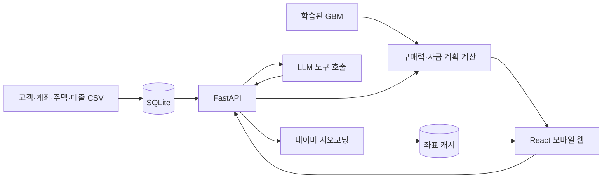

# 설계 구조

React 모바일 화면과 FastAPI 서버가 고객 재무 정보, 학습 모델, 계산 엔진, AI 채팅, 네이버 지도를 연결합니다.

## 고객별 재무 정보

`customer_id`로 전체 고객 프로필·계좌·부채 요약을 연결합니다. 주택 구매 이력이 있는 고객은 구매·대출·부동산 상세 기록도 함께 조회합니다.

구매 이력이 있는 고객의 계산에는 구매 고객 자료의 금융자산 추정액과 관측 월 소비액을 사용합니다. 구매 이력이 없는 고객은 활성 계좌 잔액 합계와 프로필의 월 소비 예산을 사용합니다. 자산 추정액과 계좌 잔액은 서로 다른 출처이므로 중복 합산하지 않습니다. 기존 월 대출 상환액도 소비와 별도로 반영합니다.

## 모델 예측과 구매력

`affordability.py`가 저장된 GBM의 주담대·한도대출 비율을 읽습니다. 안정권 상한 가격에서 예측한 비율을 같은 고객의 화면별 계산에 공유하며, 예측 가격과 안정권 상한을 반복 계산해 기준을 맞춥니다.

`finance.py`는 자기자금·예비비·부대비용을 반영해 필요한 대출을 구하고 원리금 상환액, DSR, 월 잔여금을 계산합니다. 기본 설정에서 안정권은 목표 여유자금을 유지하는 DSR 35% 이하 가격, 가능권은 월 적자가 없는 DSR 40% 이하 가격입니다. 한계권은 설정한 LTV 상한 안에서 월 10만 원을 남기는 별도 시나리오이며, 모델 대출 비율과 DSR 상한을 넘을 수 있습니다.

홈·목록·상세는 같은 계산 엔진을 사용합니다. 금리 상승 비교도 서버에서 같은 조건의 금리만 바꿔 계산합니다. 과거 주택 구매가격은 모델 입력의 시작값으로 사용하며, 현재 탐색·추천 가격의 상한으로 적용하지 않습니다.

## 단지 검색과 지도

지역·면적·거래 시작연도를 적용한 뒤 단지별 최근 거래 참조값을 선택합니다. 탐색 목록은 범위 밖 단지도 보여주고, 채팅 추천은 자금·상환 조건을 충족한 후보를 반환합니다.

지도에는 현재 조건으로 선택한 단지 ID를 전달해 목록과 같은 거래를 표시합니다. 주소는 네이버 지오코딩으로 조회하고 SQLite에 캐시합니다. 같은 위치의 단지는 묶어 표시하며, 좌표를 확인하지 못한 단지는 임의 위치에 표시하지 않습니다.

## AI 채팅

LLM은 구매 조건·후보 목록·단지 상세·지역 검색의 네 도구를 사용합니다. 서버는 응답의 단지 ID가 조회된 후보에 있는지 확인하고, 카드의 대출·상환액에는 계산 엔진의 값을 붙입니다.

현재 도구가 변경할 수 있는 검색 조건은 시군구입니다. 금리·만기·여유자금 등 계산 가정은 화면에서 저장해 적용하며, 자연어로 모든 가정을 자동 변경하는 기능은 구현되어 있지 않습니다. 대화 상태와 재조회 방식은 [채팅 메모리](implementation/chat-memory.md)를 참고하세요.

## 화면 상태와 실행 환경

계산 가정은 고객별 `localStorage`, 같은 탭의 대화 복원 정보는 `sessionStorage`에 저장합니다. 고객·가정 변경 후 이전 요청의 지연 응답이 화면을 덮지 않도록 요청 버전을 확인합니다.

서버는 SQLite와 프로세스 내 캐시를 사용하는 단일 인스턴스 구조입니다. 현재 고객 선택은 로그인 없는 교육용 데이터 시연이며, 실서비스의 인증·권한·실시간 마이데이터 연동은 후속 범위입니다.
